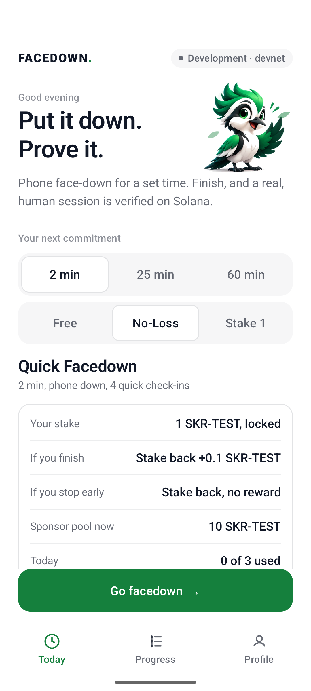
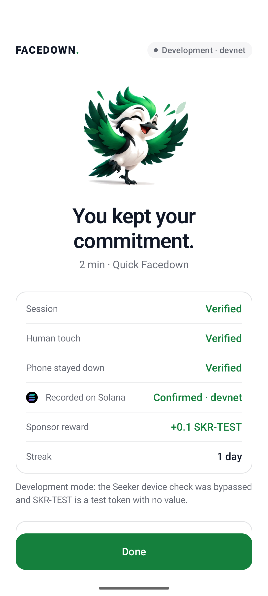
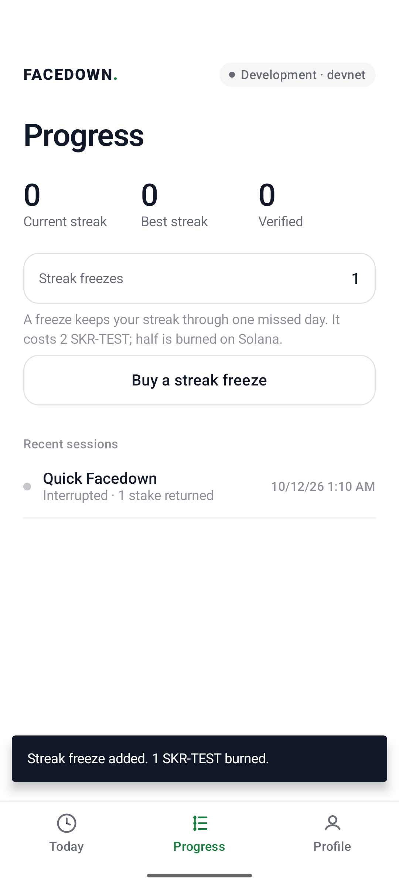
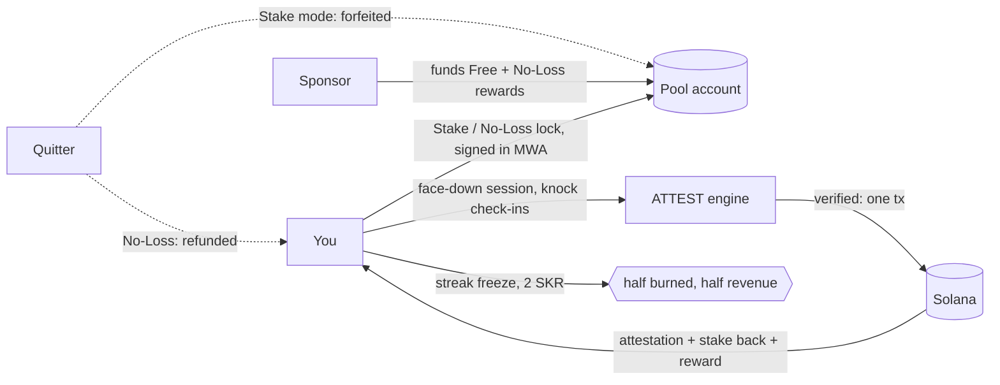

# FACEDOWN, built on PRESENCE

**Put it down. Prove it. Get paid.**

Seeker is the only phone that can prove you were present: a hardware-bound identity (Seeker Genesis Token), a
wallet in the OS, and sensors that can tell a person from a script. FACEDOWN uses that to make phone-free time
something you can commit to, verify and get paid for, with no referee.

1. **Book it.** Pick a daily time (the phone reminds you) and a length: 2 min, 25 min, or a **Facedown Hour** (60 min).
2. **Choose what's at stake.** **Free** (a sponsor pays a small reward), **No-Loss** (lock SKR; you get it back
   either way, only finishers earn) or **Stake** (finish for stake + up to 20% from the pool; quit and it feeds the pool).
3. **Turn the phone face-down.** The screen goes black. It buzzes a few times at unpredictable moments; **knock on
   the back** to answer. No pickup, no lit screen. The accelerometer proves the phone lay face-down and still, and
   that each answer was a physical knock, not input injected by a script or an AI agent.
4. **Finish.** The session is attested on Solana and paid in the same transaction. A streak builds; a **streak
   freeze** (paid in SKR, half burned on-chain) covers a missed day. Today shows how many people are facedown right now.

<p>





</p>

*Screenshots: Android emulator against **devnet** with Solana Mobile's test wallet, **development mode** (Seeker
eligibility bypassed and labeled). Face-down and knocks were driven through the emulator's virtual accelerometer.
Rewards are SKR-TEST, a valueless test mint with SKR's 6 decimals.*

## Why this, why now

**The pain is real and people pay to fix it.** Blockers are too easy to undo in the moment, and they feel like
deprivation. Commitment apps exist and charge for it, but they need a human or AI reviewer to check photo proof,
and the money you forfeit goes to the company. **FACEDOWN needs neither: the phone proves it, and forfeits go to the
people who finished** (or, in No-Loss, nothing is forfeited at all).

**In a world of AI agents, proof that a human was here is the scarce thing.** Agents can now drive a phone (tap,
type, approve) and farm anything that only checks taps. A motion signal separates human from agent-driven taps
([arXiv 2609.02154](https://arxiv.org/abs/2609.02154)); FACEDOWN puts that signal inside a signed, hash-chained,
on-chain process record. That's an anti-farming primitive, and Seeker is the phone that can carry it.

## Designed from the evidence

| Finding | What FACEDOWN does |
|---|---|
| Deposit programs were accepted by **13.7%** of people vs **90%** for reward programs; among people who'd accept either, deposits worked better (+13.2 pts). Halpern et al., [NEJM 2015](https://doi.org/10.1056/NEJMoa1414293), n = 2,538 | **Free first, No-Loss next, Stake for the committed.** |
| Appointments **more than doubled** uptake vs financial commitment devices, and most commitment-device takers lost their money. Derksen et al., [arXiv 2110.06876](https://arxiv.org/abs/2110.06876) | **Daily facedown appointment** with a reminder; No-Loss so nobody has to lose money to commit. |
| People who **chose their own** phone-reduction goal cut use by **26 min/day more** (73% larger) than people assigned one. Sachdeva, Somasundaram & Sharma (IIM Udaipur, ISB), [Soc Sci Med 2026](https://doi.org/10.1016/j.socscimed.2026.119683) | You choose the length and what's at stake. |
| Two weeks without mobile internet improved sustained attention and mental health; **91%** improved on at least one outcome. Castelo et al., [PNAS Nexus 2025](https://doi.org/10.1093/pnasnexus/pgaf017) | Long stretches matter, so there is a **Facedown Hour**, not just a pomodoro. |
| A motion signal told **human from AI-agent** taps apart with 98.4% accuracy on a table. [arXiv 2609.02154](https://arxiv.org/abs/2609.02154); zkSENSE, [arXiv 1911.07649](https://arxiv.org/abs/1911.07649) | **Knock check-ins + face-down stillness** in every checkpoint. |
| Play-/move-to-earn economies collapse; in 9 of 12 NFT games traders lost money on average. [arXiv 2602.13882](https://arxiv.org/abs/2602.13882) | **No new token, no emissions.** Rewards come only from sponsors and forfeited stakes. |

## What a cheater would try

| Attempt | Why it fails |
|---|---|
| Fake the timer / fast-forward | The **server** times the session from its own clock. Checkpoints that arrive early are rejected. |
| Use the phone during the session | Leaving the app is recorded in every checkpoint; one miss fails the session. Picking the phone up breaks face-down stillness. |
| Let a script or an AI phone agent answer | Answers are knocks felt by the accelerometer (or a finger tap's jolt). Injected input moves nothing: production rejects it (`AUTOMATION_DETECTED`). Reproduced on the emulator with adb-injected taps. |
| Replay or forge evidence | Checkpoints form a hash chain signed by a per-session Android Keystore key bound into the wallet's sign-in. |
| Farm sponsor pools with many wallets | One claim per **Seeker Genesis Token** per mission per day: a device, not a wallet. |
| Swap the stake transaction in the wallet | ATTEST submits the stake only if it moves exactly what was issued; wallets may add priority fees, nothing else. |
| Claim the payout twice | Payout and attestation are one transaction on a PDA that can be created once. |

## SKR: a reason to hold and spend it, not just pass it through



- **Stake** (opt-in): finishers get stake + up to 20% from the pool, capped by what the pool holds. If most people
  finish, the pool runs low and the bonus shrinks; we show the live pool so nobody is promised a bonus that isn't there.
- **No-Loss** (default for money): the stake is locked and returned either way (refund on failure; abandoned sessions
  are refunded after they expire). Finishing earns the sponsor reward and keeps the streak. Nobody loses principal.
- **Streak freeze** (a sink): 2 SKR, **half burned on-chain** (`BurnChecked`), half protocol revenue.
- **Real SKR** is `SKRbvo6Gf7GondiT3BbTfuRDPqLWei4j2Qy2NPGZhW3` (6 decimals). Everything is transfer-based, so
  pointing `REWARD_MINT` at it is the mainnet switch.

## Devnet proof (every row is a real transaction)

| | |
|---|---|
| Program | `CFZsFPtvwo5KDenV3qgorroaRmT7NuYsfPnd4avFS2cT` |
| SKR_TEST mint (6 decimals) | `GGqPuCZvbfmVuaUDU5AHqSxrMSbM9L3qJMP1Q7p7myRU` |
| **Face-down session** (emulator): 4/4 knocks, human touch + phone-down verified, attestation + sponsor reward | [2R1V…xiit](https://explorer.solana.com/tx/2R1VrBwdbkXkpfZ1eQLRAkM6BNMXryes7u3KAQs689QRw6PBNw1PUxzTRz5PfhatMRPSHy5JRxnHwFvEgNiWxiit?cluster=devnet) |
| **No-Loss**: quit mid-session, stake refunded | [a6Em…iE1](https://explorer.solana.com/tx/a6Em7BAUah1osjjuJUWzi9JHAqsycLuAtyhthDXUVZwG1jJ5q5gTr4ZzsJioWiA1pAA4eXRRXVA2kiF1cjpiiE1?cluster=devnet) |
| **Streak freeze**: 2 SKR-TEST paid | [7qc5…R9r](https://explorer.solana.com/tx/7qc5aKgJ76qzy8idtPqSxtrfDbtcjqbPcpJ5rLLbzn1pHbB4pJGBsPS5QQkNMscSee4wBpkJCZvkK2ED25KeR9r?cluster=devnet), 1 SKR-TEST **burned** [2FDV…aMf](https://explorer.solana.com/tx/2FDVJdb2azN4pAD3cPEjn3bdzXCDrvXvaV586kMoDzYBkkxt1xTZngBqvBxwdumNYdTMDKTifTvWPMDrwAXESaMf?cluster=devnet) |
| Real phone + Solflare (pre-face-down build): stake of 1 SKR-TEST | [yKF8…qnt](https://explorer.solana.com/tx/yKF8g4evQLErYHiELKfR5sHHPyyFq1nkGPZSG4bLV6vZ4tfsgf4o3TX2f3Jz7pfzQkhMjwzn6Ce16WWLBZn8qnt?cluster=devnet) |
| Real phone + Solflare: finished, attestation + stake back + 0.2 bonus | [5vbS…i6Nd](https://explorer.solana.com/tx/5vbSaLXNDUZ1Q2zMqKBrV1n4a5wEqiPRSficKMqeckktqczxPraxxrPtcLgVfx2rgm45YNAcsaMzLADK9KmHi6Nd?cluster=devnet) |
| Real phone + Solflare: free session, attestation + 0.1 sponsor reward | [2gtc…obNu](https://explorer.solana.com/tx/2gtcaWDPiB3uanDdia8iP6n96G6oTDnb4VjMJjWT2JAzRytcQh8cKB3wbSj16Rvi6yepuVWqCiZnKKEERPrZobNu?cluster=devnet) |
| Real phone + Solflare: left the app, stake forfeited to the pool | [3RAz…3aPk](https://explorer.solana.com/tx/3RAz2dQsauyHM2eDqNvRk2utexRqNRYBkEhw7pR1Zdxi7DMWy9PCo3DAqLer56CP3cvNnJmaLEpxirAo4azi3aPk?cluster=devnet) |

## The business: FACEDOWN is the first app, PRESENCE is the company

- **Consumer (FACEDOWN):** sponsor-funded Free and No-Loss tiers for reach; streak freezes as an SKR sink and
  revenue; later a Pro tier and a small rake on opt-in Stake pools (where legal).
- **Infrastructure (PRESENCE):** "a human did this process on this device", verifiable on-chain by anyone through
  `verifyPresence()` ([docs/integration.md](docs/integration.md)). Every airdrop is a Sybil problem and every quest
  program is a farming problem; PRESENCE sells proof-of-human-process per attestation to airdrop issuers, quest
  platforms and Seeker campaigns ("5 verified facedown sessions" is a quest a bot can't farm).
- **Sponsors:** parents funding a student's pool, companies funding employees' focus hours, protocols funding
  campaigns. Sponsor deposits are verified on-chain before they're credited.

## The engine: PRESENCE

- **Client collects, ATTEST decides, chain anchors.** The app never sends `verified`, `reward` or `assurance`.
- **Evidence chain.** `checkpoint_i = SHA256("PRESENCE/cp/v3" | prev | "{i}|{ts}|{elapsed}|{fg}|{taps}|{response_ms}|{still_pct}|{touch_motion}" | nonce)`,
  identical in Kotlin and Python (shared golden vectors).
- **Privacy.** Per window: a foreground flag, an answer count, one answer time and two motion summaries (how much of
  the time the phone lay still and face-down, how hard the knock was). Raw sensor data stays on the phone. No
  location, contacts, camera or microphone. Only a 32-byte root goes on-chain.
- **Assurance levels.** P1 = wallet sign-in + Seeker Genesis Token, P2 = P1 + process evidence. P3 (witnesses) and
  P4 (hardware attestation) are designed, not built.

Docs: [architecture](docs/architecture.md) · [trust model](docs/trust-model.md) ·
[evidence](docs/evidence-model.md) · [security](docs/security.md) · [missions](docs/mission-policy.md) ·
[integration](docs/integration.md) · [demo script](docs/demo.md)

## Roadmap (designed, not built)

- **Yield-funded No-Loss.** On mainnet, locked stakes can earn yield (e.g. a USDC/SOL lending vault) that funds the
  finisher reward instead of sponsors. Not built: no such vault on devnet to test against.
- **ORE sponsor pools ("your focus fills an ORE jar").** A mission whose reward mint is ORE, funded by an ORE
  sponsor, so finishers accumulate ORE as savings. We deliberately do *not* deploy users' SOL into ORE mining rounds
  on their behalf: that is a game of chance and would undo No-Loss. Not built: ORE (`oreV3EG1i9BEgiAJ8b177Z2S2rMarzak4NMv1kULvWv`)
  runs on mainnet only, and per-mission reward mints need a settlement change.
- **Presence Model.** Replace the hand-tuned knock/stillness thresholds with a small on-device classifier trained on
  real session traces (opt-in). Not built: we don't have the data yet, and a model without data would be theatre.
- **Live Rooms.** Friends, a college or a company facedown together. Today there is one global live count.
- **Guardian quorum.** Several attestors staking SKR instead of one operator ([trust-model.md](docs/trust-model.md)).

## Honest limitations

- **Face-down was verified on the emulator, not yet on a real phone.** Knocks and face-down came from the
  emulator's virtual accelerometer. The earlier face-up build ran end to end on a real realme phone with Solflare on
  devnet (table above). Seeker Genesis Token verification is implemented and unit-tested but not run on a Seeker.
- **Thresholds are uncalibrated.** On a real phone, injected taps still read 20–90 mm/s² of noise (one 734 outlier);
  the human-touch threshold is 150 and knocks register above 350. They need tuning with real knocks on several phones.
- **This phone, not you.** It proves *this* device lay face-down with a person answering. It can't stop you using a
  second phone. In No-Loss you only cheat yourself; in sponsored pools the Genesis Token caps it to one device.
- **Signals, not proof.** A modified app could fabricate the motion numbers; only hardware attestation (P4) closes that.
- **Indian law.** Paying finishers out of quitters' stakes (Stake mode) may count as an "online money game" under
  India's 2025 online gaming law. Free and No-Loss pay only from sponsors and never take principal. Stake mode needs
  legal review before a public launch in India.
- **Single operator.** One attestor key and one ATTEST server.
- **Test tokens only.** Devnet and localnet use SKR-TEST and a dev-only faucet, which the server refuses on mainnet.

## Run it

```bash
. scripts/toolchain.env
anchor build
scripts/dev_stack.sh                 # validator + program + SKR_TEST pools + ATTEST (dev mode) on :8787
./gradlew :app:installDebug          # emulator reaches the host at 10.0.2.2
```

Install Solana Mobile's `fakewallet-v1-debug.apk`
([MWA releases](https://github.com/solana-mobile/mobile-wallet-adapter/releases)) on the emulator. New test wallets
are funded by the dev faucet on connect. For devnet: `scripts/devnet_setup.sh`, then `scripts/fund_pool.sh`.
On the emulator, `adb emu sensor set acceleration 0:0:-9.81` turns the phone face-down.

## Tests

```bash
cd backend && uv run pytest -q                 # 43 tests: protocol, replay, policy, physical evidence, stakes, No-Loss, freezes, pools
scripts/e2e_localnet.sh                        # real chain: deposit, stake round trip, forged stake refused, payout, SDK
anchor test --validator legacy                 # program: attestor auth, day range, claim index, streak, double settlement
./gradlew :app:testDebugUnitTest               # evidence chain = Python golden vectors; knock / face-down / stillness detector
python3 scripts/device_e2e.py <adb-serial> happy free leave   # drives the real app + wallet on a device/emulator
ATTEST_ENFORCE_PHYSICAL=true scripts/dev_stack.sh   # then `device_e2e.py emulator-5554 free`: injected taps are rejected
```
