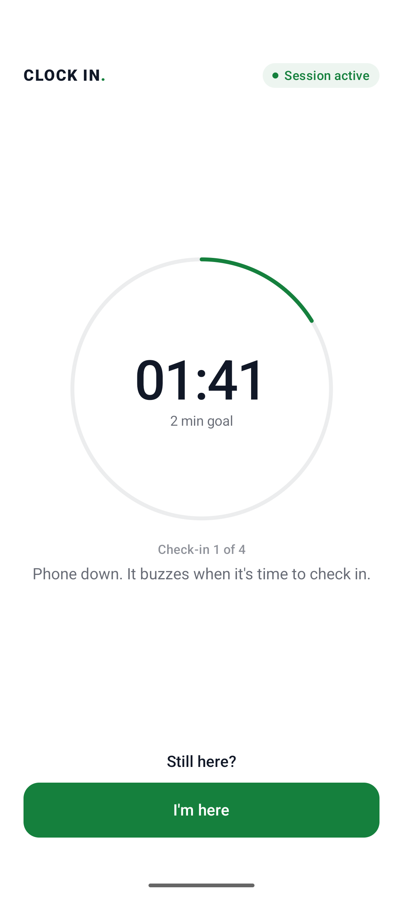
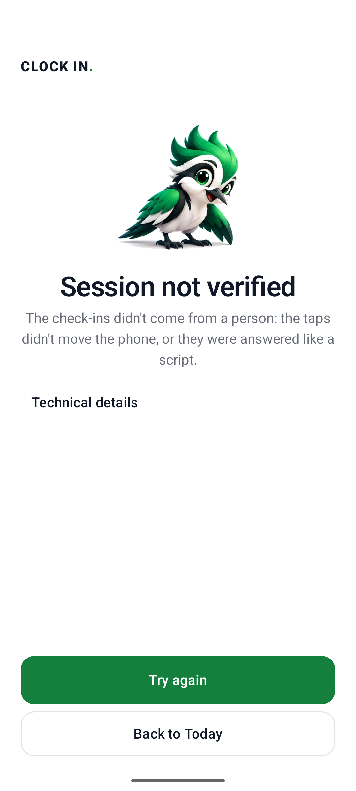
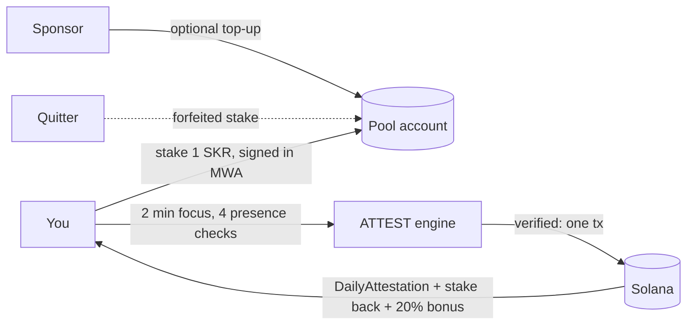

# CLOCK IN, built on PRESENCE

**Focus you can prove, and that no script or AI agent can fake.**

Every Seeker owner knows the loop: you pick up the phone to do one thing and lose twenty minutes. CLOCK IN is a
daily appointment with your own attention:

1. **Book it and choose it.** Pick a daily time (the phone reminds you), a length (2 or 25 min), and **Free** (a
   sponsor pays a small reward, nothing of yours at risk) or **Stake** SKR.
2. **Put the phone down** face-up on a table. It buzzes once per window at an unpredictable moment. Tap *I'm here*.
   The accelerometer feels that a **finger** touched the phone and that it **lay still** between check-ins.
3. **Finish:** the session is attested on Solana; a staked stake comes back **plus up to 20%**, in the same
   transaction. **Quit, switch apps, miss a check, or let a script tap for you:** not verified; a stake goes to the pool.

<p>





</p>

**Demo video:** [`demo/clock-in-demo-2x.mp4`](demo/clock-in-demo-2x.mp4) (3 min at 2× speed): a staked session that
finishes (stake back + bonus), then one that leaves the app (stake forfeited to the pool). Recorded on the emulator,
with the app and wallet driven by `scripts/device_e2e.py`.

*Screenshots: Android emulator with Solana Mobile's test wallet, local validator, **development mode** (Seeker
eligibility bypassed and labeled). Rewards are SKR-TEST, a valueless test mint with SKR's 6 decimals.*

## Designed from the evidence

Every product decision maps to a randomized trial or a paper, not a guess:

| Finding | What CLOCK IN does |
|---|---|
| Deposit programs were accepted by **13.7%** of people vs **90%** for reward programs; among people who'd accept either, deposits worked better (+13.2 pts). Halpern et al., [NEJM 2015](https://doi.org/10.1056/NEJMoa1414293), n = 2,538 | **Free first, stake later.** Sponsor-funded sessions are the default way in; staking is the upgrade for the committed. |
| Appointments **more than doubled** uptake vs financial commitment devices, and most commitment-device takers lost their money. Derksen et al., [arXiv 2110.06876](https://arxiv.org/abs/2110.06876) | **Daily focus appointment** with a reminder; a missed appointment costs nothing. |
| People who **chose their own** phone-reduction goal cut use by **26 min/day more** (73% larger) than people assigned one, same incentives. Sachdeva, Somasundaram & Sharma (IIM Udaipur, ISB), [Soc Sci Med 2026](https://doi.org/10.1016/j.socscimed.2026.119683) | You choose the length and whether to stake. |
| A motion signal told **human from AI-agent** taps apart with 98.4% accuracy on a table. [arXiv 2609.02154](https://arxiv.org/abs/2609.02154); ZK motion humanness: zkSENSE, [arXiv 1911.07649](https://arxiv.org/abs/1911.07649) | **Physical evidence** in every checkpoint: each tap must move the phone, and the phone must lie still. |
| Two weeks without mobile internet improved sustained attention and mental health; **91%** improved on at least one outcome. Castelo et al., [PNAS Nexus 2025](https://doi.org/10.1093/pnasnexus/pgaf017) | Why phone-down time is worth proving. |
| Play-/move-to-earn economies collapse; in 9 of 12 NFT games traders lost money on average. [arXiv 2602.13882](https://arxiv.org/abs/2602.13882), [arXiv 2211.01000](https://arxiv.org/abs/2211.01000) | **No new token, no emissions.** Rewards come only from sponsors and forfeited stakes. |

## Why nobody has done this before

Focus apps run on a **local timer**. Anyone can fake one, so nobody can put money on them. Commitment contracts work
(in a randomized trial, smokers offered a deposit contract were 3 points more likely to quit, effects lasting a year,
[Giné, Karlan & Zinman](https://poverty-action.org/publication/put-your-money-where-your-butt)), but only when
someone can check the outcome.

**PRESENCE is that check, with no referee:**

| What a cheater would try | Why it fails |
|---|---|
| Fake the timer / fast-forward | The **server** times the session from its own clock. Checkpoints that arrive early are rejected. |
| Leave the app and come back | Every checkpoint records whether the session stayed in the foreground. One miss forfeits the stake. |
| Script the taps | Checks appear at random moments; answer times that are instant or metronome-steady are flagged `AUTOMATION_DETECTED`. |
| Let an AI phone agent tap for you | Injected taps don't move the phone. Each checkpoint carries the accelerometer jolt of the tap; production rejects taps no finger made (`AUTOMATION_DETECTED`). Reproduced on the emulator with adb-injected taps. |
| Replay or forge evidence | Checkpoints form a hash chain signed by a per-session Android Keystore key bound into the wallet's sign-in. |
| Farm the bonus pool with many wallets | One claim per **Seeker Genesis Token** per mission per day: a device, not a wallet. |
| Claim the payout twice | Payout and attestation are one transaction on a PDA that can be created once. |

This builds on a security idea formalized in 2026: real-time human attention is a scarce resource that can't be
parallelized, so time-bound, identity-bound challenges make sustaining *s* fake identities cost grow linearly with *s*
([Human Challenge Oracle, arXiv 2601.03923](https://arxiv.org/abs/2601.03923)). Seeker adds what that paper's
browser setting lacks: a hardware-bound identity per device.

## Why it fits CLOCK IN

- **Stickiness:** a daily appointment, streak, league and money at stake. Behavioural research suggests appointments
  beat open-ended commitments ([arXiv 2110.06876](https://arxiv.org/abs/2110.06876)), so each session is a scheduled
  clock-in rather than a vague goal.
- **Seeker-native:** the Seeker Genesis Token makes the pool Sybil-resistant per device, and Mobile Wallet Adapter
  signs the sign-in and the stake in one prompt.
- **SKR as the core mechanic, not decoration:** you stake SKR, finishers earn SKR, quitters fund the pool, and
  sponsors can top it up.

## How SKR moves



- **Stake.** ATTEST builds the transfer; the wallet signs it together with the sign-in message; ATTEST submits it
  only if it moves exactly what was issued (same payer, accounts, mint and amount). Wallets may add priority-fee
  instructions, as Solflare does; any other change is refused.
- **Pay.** On success, `record_attestation` and a `TransferChecked` of *stake + bonus* from the pool go in **one
  transaction**. The bonus is capped by what the pool holds.
- **Forfeit.** Rejected sessions, and sessions abandoned until they expire, leave their stake in the pool.
- **Real SKR** is `SKRbvo6Gf7GondiT3BbTfuRDPqLWei4j2Qy2NPGZhW3` (classic SPL Token, 6 decimals). We can't mint it,
  which is why everything is transfer-based. Pointing `REWARD_MINT` at it is the mainnet switch.

**Devnet (live):**

| | |
|---|---|
| Program | `CFZsFPtvwo5KDenV3qgorroaRmT7NuYsfPnd4avFS2cT` |
| SKR_TEST mint (6 decimals) | `GGqPuCZvbfmVuaUDU5AHqSxrMSbM9L3qJMP1Q7p7myRU` |
| Example: 2-min session attested, 1 SKR-TEST stake + 0.2 bonus paid in one tx | [3nPy…FdA](https://explorer.solana.com/tx/3nPyCXQkQ8AFKm6pAXSJYpTpLeAHwj9J98xfZ5sKBEJ4Vmpo5q8bvSnCqyTvEXB3yna5Ua9VLXRK7FXtnUxezFdA?cluster=devnet) |
| Real phone + Solflare: stake of 1 SKR-TEST | [yKF8…qnt](https://explorer.solana.com/tx/yKF8g4evQLErYHiELKfR5sHHPyyFq1nkGPZSG4bLV6vZ4tfsgf4o3TX2f3Jz7pfzQkhMjwzn6Ce16WWLBZn8qnt?cluster=devnet) |
| Real phone + Solflare: finished, attestation + stake back + 0.2 bonus | [5vbS…i6Nd](https://explorer.solana.com/tx/5vbSaLXNDUZ1Q2zMqKBrV1n4a5wEqiPRSficKMqeckktqczxPraxxrPtcLgVfx2rgm45YNAcsaMzLADK9KmHi6Nd?cluster=devnet) |
| Real phone + Solflare: free session, attestation + 0.1 sponsor reward | [2gtc…obNu](https://explorer.solana.com/tx/2gtcaWDPiB3uanDdia8iP6n96G6oTDnb4VjMJjWT2JAzRytcQh8cKB3wbSj16Rvi6yepuVWqCiZnKKEERPrZobNu?cluster=devnet) |
| Real phone + Solflare: left the app, stake forfeited to the pool | [3RAz…3aPk](https://explorer.solana.com/tx/3RAz2dQsauyHM2eDqNvRk2utexRqNRYBkEhw7pR1Zdxi7DMWy9PCo3DAqLer56CP3cvNnJmaLEpxirAo4azi3aPk?cluster=devnet) |

## The engine: PRESENCE

CLOCK IN is the first product on **PRESENCE**, a general engine for "prove a person actually did this process":

- **Client collects, ATTEST decides, chain anchors.** The app never sends `verified`, `reward` or `assurance`.
- **Evidence chain.** `checkpoint_i = SHA256("PRESENCE/cp/v3" | prev | "{i}|{ts}|{elapsed}|{fg}|{taps}|{response_ms}|{still_pct}|{touch_motion}" | nonce)`,
  identical in Kotlin and Python (shared golden vectors).
- **Privacy.** Per window: a foreground flag, a tap count, one answer time and two motion summaries (how still the
  phone lay, how much the tap moved it). Raw sensor data stays on the phone. No location, contacts or background tracking. Only a 32-byte root goes on-chain.
- **Assurance levels.** P1 = wallet sign-in + Seeker Genesis Token, P2 = P1 + process evidence. P3 (witnesses) and
  P4 (hardware attestation) are designed, not built.
- **`verifyPresence()` SDK.** Any app can check an attestation on Solana without trusting our server
  ([docs/integration.md](docs/integration.md)).

The same engine extends to verified field work (health-worker visits, cold-chain handovers). That's the roadmap,
not this submission: those users don't carry Seekers yet, and those claims need place-binding we haven't built.

Docs: [architecture](docs/architecture.md) · [trust model](docs/trust-model.md) ·
[evidence](docs/evidence-model.md) · [security](docs/security.md) · [missions](docs/mission-policy.md) ·
[integration](docs/integration.md) · [demo script](docs/demo.md)

## Honest limitations

- **Tested on a real Android phone, not a Seeker.** On a realme phone with Solflare on devnet we ran a staked session
  (stake back + bonus), a free one (sponsor reward) and one that left the app (stake forfeited), all with real
  transactions. Seeker Genesis Token verification is implemented and unit-tested but not run on a Seeker; every run
  used development mode, which is labeled on every screen and receipt.
- **This phone, not you.** It proves *this* device stayed on the session with a person answering. It can't stop you
  using a second phone.
- **Heuristics, not proof.** Automation detection catches naive scripts; a script with human-like random delays can pass.
- **Motion thresholds are uncalibrated.** The finger-tap and stillness rules work on synthetic traces and catch
  adb-injected taps on the emulator, but they haven't been tuned on real phones yet. A modified app could also fake
  the two numbers; only hardware attestation (P4) closes that.
- **Indian law.** Paying finishers a bonus out of quitters' stakes may count as an "online money game" under India's
  online gaming law (2025). The Free tier pays only from sponsors. Staking needs legal review before a public launch in India.
- **Single operator.** One attestor key and one ATTEST server. A Guardian quorum staking SKR is designed, not built
  ([trust-model.md](docs/trust-model.md)).
- **Test tokens only.** Devnet and localnet use SKR-TEST and a dev-only faucet, which the server refuses on mainnet.

## Run it

```bash
. scripts/toolchain.env
anchor build
scripts/dev_stack.sh                 # validator + program + SKR_TEST pools + ATTEST (dev mode) on :8787
./gradlew :app:installDebug          # emulator reaches the host at 10.0.2.2
```

Install Solana Mobile's `fakewallet-v1-debug.apk`
([MWA releases](https://github.com/solana-mobile/mobile-wallet-adapter/releases)) on the emulator. New test wallets
are funded by the dev faucet on connect. For devnet: `scripts/devnet_setup.sh`, then `scripts/fund_pool.sh`.

## Tests

```bash
cd backend && uv run pytest -q                 # 39 tests: protocol, replay, policy, physical evidence, stakes, wallet edits, forfeits, pools
scripts/e2e_localnet.sh                        # real chain: deposit, stake round trip, forged stake refused, payout, SDK
anchor test --validator legacy                 # program: attestor auth, day range, claim index, streak, double settlement
./gradlew :app:testDebugUnitTest               # Kotlin evidence chain = Python golden vectors; tap/stillness detector
python3 scripts/device_e2e.py <adb-serial> happy free leave   # drives the real app + wallet on a device/emulator
ATTEST_ENFORCE_PHYSICAL=true scripts/dev_stack.sh   # then `device_e2e.py emulator-5554 free`: injected taps are rejected
```
